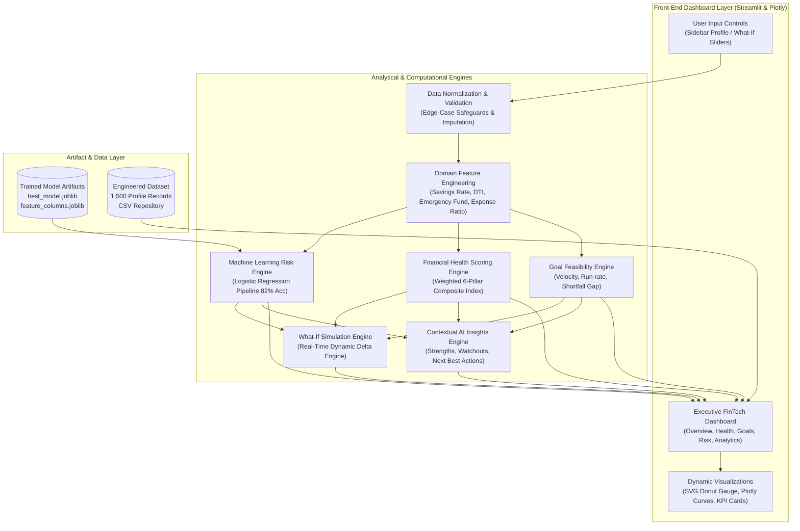

# System Architecture & Design
## WealthSphere: High-Level System Architecture & Flow

The **WealthSphere** architecture follows a modular, decoupled pipeline where consumer financial inputs are ingested, preprocessed, passed through domain feature transformers, scored by analytical engines and serialized ML models, and rendered through interactive front-end components.

---

## 1. Architectural Diagram (Mermaid)

---

## 2. Component Layer Breakdown

### Layer 1: Ingestion & Validation Layer
* Accepts consumer profile parameters (Monthly Income, Monthly Expense, Current Savings, Total Debt, Goal Amount, Horizon, and Risk Preference).
* Implements mathematical edge-case validation to guard against division-by-zero, negative inputs, and missing values.

### Layer 2: Feature Engineering & Transformation Layer
* Computes derived analytical variables: `savings_rate_calculated`, `debt_to_income_calculated`, `emergency_fund_months`, `expense_ratio`, `monthly_surplus`, and `goal_progress_percent`.
* Formats feature vectors matching the 9-dimensional schema expected by the machine learning pipeline.

### Layer 3: Predictive & Analytical Core
* **ML Risk Classifier**: Employs the trained Logistic Regression pipeline to infer the consumer's probability spectrum across `Low`, `Moderate`, and `High` risk personas.
* **Financial Health Engine**: Calculates the 100-point composite score across the 6 weighted dimensions and categorizes health into `Poor`, `Needs Improvement`, `Moderate`, or `Good`.
* **Goal Feasibility Engine**: Projects monthly accumulation run-rates, computes shortfall gaps, and assigns status (`Already Achieved`, `On Track`, `Needs Higher Monthly Saving`).

### Layer 4: Interactive Simulation & Insights Layer
* **What-If Sandbox**: Ingests interactive slider deviations, re-runs the analytical pipeline in-memory, and calculates delta metrics ($\pm \Delta$ Score, $\pm \Delta\%$ Goal, Persona Shift).
* **AI Insights Generator**: Programmatically generates diagnostic bullet points evaluating top strengths, primary warning signs, and next best actions.

### Layer 5: Presentation & Visualization Layer
* Formats all metrics into clean KPI cards, custom SVG progress rings, and responsive Plotly charts within a modern Streamlit user interface.
